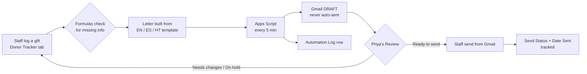

# Donor Thank-You Tracker & Gmail Draft Automation

A Google Sheets + Apps Script tool for **Linden Street Community Partners** (a case-study nonprofit) that turns every logged donation into a warm thank-you letter in the donor's language, drops it into Gmail as a **draft**, and holds it for staff review before anything is sent.

> **All data in this repo is fictional.** Donor names use `example.com` addresses, and the EIN is a placeholder (`00-1234567`). No real donor, client, or organization data is included.

---

## The problem

Linden Street's Development and Communications Manager handles all fundraising and communications alone. In a discovery interview she described the thank-you letter workflow:

- About **120 donations a month**
- Each letter written one at a time in Google Docs, at **about 12 minutes per letter**
- Names and amounts **checked by hand** against the donation spreadsheet
- Running **2–3 weeks behind**, and the backlog grows every week

That works out to about **24 hours a month** spent on one repetitive task. A previous attempt with a general AI chatbot produced copy that "didn't sound like Linden Street," so she went back to writing everything from scratch.

## What this tool does

1. **One row per gift.** Staff enter each gift on the `Donor Tracker` tab: name, email, language, date, amount, first-time or repeat, and optionally a program designation, a tribute, or a special note from the donor.
2. **It never guesses.** Blank fields stay blank. The `Missing Info` column lists exactly what's missing, `Data Check` marks the row *Complete* or *Incomplete*, and any gap appears in the letter as a visible `[placeholder]`.
3. **Letters in three languages.** Each row builds a subject and body in **English, Spanish, or Haitian Creole** from editable templates, written in a relaxed, conversational voice with no corporate filler.
4. **It creates Gmail drafts, never sends.** Every 5 minutes, an Apps Script trigger finds rows that are ready for a draft, creates a **Gmail draft**, and writes the draft ID back to the row. If the row changes later, the draft updates to match, unless someone has already edited it in Gmail.
5. **A person approves every letter.** The Development Manager sets each row in **Priya's Review** to *Not reviewed*, *Ready to send*, *Needs changes*, or *On hold*. Only letters marked *Ready to send* should go out.
6. **Every draft is logged.** Each time the script creates or updates a Gmail draft, it adds a row to the `Automation Log` tab, so anyone can see what happened and when. See [Automation Log](#automation-log).
7. **Mistakes get caught.** A red **CHECK** flag appears if a row is marked *Ready to send* while information is still missing. **SENT WITHOUT APPROVAL** shows in red if an email goes out before it was approved.

## Workbook structure

| Tab | Purpose |
|---|---|
| **Donor Tracker** | One row per gift. Navy columns are inputs, grey columns are formulas, green columns are review and send tracking. |
| **Email Drafts** | Builds the subject and body for each row in the donor's language, plus helper columns (formatted amount, localized date, donor line, program line, tribute line). |
| **Draft Preview** | Shows one letter in full, for comfortable reading. |
| **Templates** | Editable letter wording per language, using `{{TOKENS}}`. |
| **Lookups** | Month names in each language (for localized dates) and the program designation list. |
| **Instructions** | Plain-English how-to for staff, a column guide, and a color legend. |
| **Automation Log** | One row per Gmail draft created or updated by the script. |

See [`tracker/tracker-schema.md`](tracker/tracker-schema.md) for every column.

## Automation Log

The script records every draft it touches on the `Automation Log` tab. The log is append-only: rows are never edited or deleted, so it works as an audit trail for anyone checking the work later.

**When a row is written**

| Event | Status logged |
|---|---|
| A new Gmail draft is created for a tracker row | `Draft ready for Priya's review` |
| An existing draft is rewritten because its row changed (only if nobody edited the draft in Gmail) | `Draft updated to match the Sheet` |

Rows that are skipped aren't logged. That covers runs where nothing changed, drafts someone edited by hand in Gmail, and rows that already have a Date Sent. Because of this, a run every 5 minutes doesn't fill the log with noise.

**What each row captures**

`Run Time · Donor ID · First Name · Email · Language · Gift Date · Amount · Donor Type · Special Note · Missing Info · Gmail Draft ID · Tracker Row · Status`

- **Missing Info** is copied from the tracker at the moment the draft was made. The log shows what the letter was missing when it was drafted, even if the gap was filled in later.
- **Gmail Draft ID** and **Tracker Row** link each entry back to the exact draft and the exact row in the sheet.
- Values are stored as plain text, exactly as they appear in the tracker, so IDs, dates, and amounts aren't reformatted.
- All entries from one run share the same Run Time and are written in a single batch.

**Example**

| Run Time | Donor ID | First Name | Language | Gift Date | Amount | Missing Info | Tracker Row | Status |
|---|---|---|---|---|---|---|---|---|
| Nov 7, 2026 12:29 PM | LS-006 | Mike | | Nov 3, 2026 | $40.00 | Language; First-time/Repeat | 8 | Draft ready for Priya's review |
| Nov 8, 2026 3:27 PM | LS-028 | Mary | English | | $40.00 | Email; Gift date | 30 | Draft ready for Priya's review |

*(Some columns are hidden here to save space. All data is fictional.)*

If the `Automation Log` tab is missing, the script creates it with the correct headers on its next run.

## Design decisions

- **Templates instead of free-form AI generation.** The earlier chatbot draft failed because it sounded generic and added filler. Here the voice is written once, reviewed, and then reused. Every fact in a letter comes from a cell in the sheet, so the letter can't make up an amount, a date, or a program.
- **Drafts, not sends.** Donor letters are public-facing and touch financial details, so a named person reviews each one before it goes out.
- **Visible gaps instead of silent ones.** A `[Gift date]` placeholder in a draft is easy to spot. A guessed date isn't.
- **First-time vs. repeat is entered by a person.** The sheet doesn't decide donor history. Staff confirm it against the main donor database.
- **The special note isn't inserted into the letter.** A donor's note is shown to the reviewer so she can choose to reply personally.
- **Tax-receipt line included.** Each letter includes the EIN and a "no goods or services" statement. The reviewer checks that it fits each gift; for example, it wouldn't fit an event ticket.
- **A log that only records changes.** Logging every 5-minute check would bury the useful entries, so the log records only drafts that were created or updated.
- **Translations get a fluent check.** The Spanish and Haitian Creole templates are first drafts and should be reviewed by a fluent speaker before first use.

## Tech stack

| Piece | Tool | Cost |
|---|---|---|
| Data, formulas, templates | Google Sheets | Included in Google Workspace |
| Automation | Google Apps Script (time-driven trigger, every 5 min) | Free |
| Email | Gmail drafts via `GmailApp` | Included |

There are no third-party services, no API keys, and no per-run credits. Everything stays inside the organization's existing Google Workspace, so donor data never leaves it.

## Setup

1. Make a copy of the Sheet structure (see `tracker/`), or import `tracker/sample-donor-tracker.csv` into a `Donor Tracker` tab.
2. Paste the templates from [`templates/letter-templates.md`](templates/letter-templates.md) into a `Templates` tab, and enter the organization's EIN in `Templates!B12`.
3. Open **Extensions → Apps Script**, paste in the code from [`apps-script/`](apps-script/), and save.
4. Reload the Sheet and use the **Thank-You Letters** menu to turn on automatic drafts. Approve the Google permission prompts. The script only needs Sheets and Gmail.
5. Add a test row and wait up to 5 minutes. A draft should appear in Gmail, and a row should appear in `Automation Log`.

> **Demo mode:** in this build, all drafts are addressed to a single test inbox (`donor.test@example.com`) instead of the donor's email. Change the recipient setting in the script before real use.

## Testing

The test cases cover clean entries, each language, missing data, and a "marked ready but incomplete" case. See [`tests/test-log.md`](tests/test-log.md).

## Impact estimate

| | Before | After (estimate) |
|---|---|---|
| Time per letter | ~12 min (write + check by hand) | ~3 min (review the draft and send) |
| Letters / month | ~120 | ~120 |
| Hours / month | **~24 hrs** | **~6 hrs** |

**About 18 hours a month back.** *Assumption:* review takes about 3 minutes per letter once staff are used to it. This hasn't been measured yet. To confirm it, track review time for the first four weeks and compare the backlog (days from gift to thank-you) before and after.

## What it won't do

- It never sends an email on its own.
- It doesn't decide whether a donor is first-time or repeat.
- It doesn't fill in missing information. Gaps are flagged.
- It doesn't insert the donor's special note into the letter.

## What I'd build next

- A Google Form for gift entry, so staff don't have to edit the sheet directly
- A weekly digest email listing every letter waiting for review
- Checking for duplicate donor IDs or emails before drafting
- Lookups against the main donor database to suggest first-time or repeat for staff to confirm

## About this project

I built this as a portfolio project during an AI consulting fellowship, working from a case-study nonprofit and discovery interviews with its staff. All data is invented.

**Built by:** Kevon Priester
